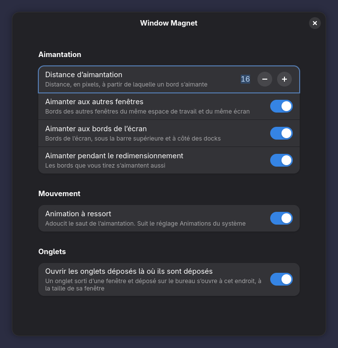

# Window Magnet

[](https://github.com/maximeallanic/window-magnet/actions/workflows/ci.yml)
[](LICENSE)
[](#compatibilité)

*[Read in English](README.md)*

Une extension GNOME Shell qui rend les bords des fenêtres magnétiques. Approchez une fenêtre d'une autre : son bord
vient se coller contre elle, avec un petit ressort qui rend l'aimantation physique plutôt que brusque. Tirez un peu
plus loin, elle se décroche.


*Enregistré dans un vrai GNOME Shell 51 (imbriqué, sans écran), à vitesse réelle. [Version MP4](media/demo.mp4).*

## Fonctions

- **Aimantation au déplacement** : les deux bords de chaque axe s'aimantent aux bords des autres fenêtres du même
  espace de travail et du même écran, et aux bords de l'écran (sous la barre supérieure, à côté des docks). Les hauts
  s'alignent, les côtés se touchent.
- **Aimantation au redimensionnement** : les bords que vous tirez s'aimantent aussi, en direct, sans que la fenêtre
  hésite entre deux tailles.
- **Un ressort, pas un à-coup** : chaque aimantation est adoucie par un ressort rapide Material 3 Expressive. Il suit
  le réglage *Réduire les animations* de GNOME.
- **Tient, puis lâche** : une fenêtre aimantée reste en place tant que le pointeur ne s'éloigne pas de plus que la
  distance d'aimantation.
- **Les onglets s'ouvrent là où on les dépose** : un onglet sorti d'une fenêtre et déposé sur le bureau ouvre sa
  fenêtre à l'endroit du dépôt, à la taille de la fenêtre d'origine (sous Wayland, une application ne peut pas placer
  ses fenêtres elle-même).
- Rien d'autre ne change : pas de pavage, pas de raccourcis clavier, pas de changement de style. Elle n'agit que
  pendant un glisser.

## Installation

### Depuis extensions.gnome.org

Pas encore publiée. Une fois qu'elle le sera, ce sera le plus simple : depuis le site ou l'application
*Gestionnaire d'extensions*.

### En une commande

```sh
curl -fsSL https://raw.githubusercontent.com/maximeallanic/window-magnet/main/install.sh | bash
```

Le script télécharge depuis GitHub le zip de la version épinglée, vérifie son SHA-256 contre la valeur écrite dans
`install.sh`, l'installe pour votre utilisateur avec `gnome-extensions install` et l'active. Ni root, ni outils de
compilation. Sous Wayland, **déconnectez-vous puis reconnectez-vous une fois** après la première installation : GNOME
Shell découvre les nouvelles extensions à l'ouverture de session. Vous pouvez lire le script avant : il est court et
commenté.

### À la main, depuis le zip

1. Téléchargez `window-magnet@maximeallanic.github.io.shell-extension.zip` depuis la
   [dernière version](https://github.com/maximeallanic/window-magnet/releases/latest)
   (et `SHA256SUMS` pour le vérifier : `sha256sum -c SHA256SUMS`).
2. Installez-le : `gnome-extensions install --force window-magnet@maximeallanic.github.io.shell-extension.zip`
3. Déconnectez-vous et reconnectez-vous, puis : `gnome-extensions enable window-magnet@maximeallanic.github.io`

### Depuis les sources

```sh
git clone https://github.com/maximeallanic/window-magnet.git
cd window-magnet
./install.sh --from-source       # demande gettext (msgfmt) pour compiler les traductions
```

### Vérifier que tout marche

```sh
curl -fsSL https://raw.githubusercontent.com/maximeallanic/window-magnet/main/verify.sh | bash
```

`verify.sh` ne modifie rien. Il contrôle la version de GNOME Shell, l'installation, le schéma de réglages, l'activation
et le fonctionnement de l'extension, et dit quoi faire pour tout ce qui ne va pas (messages en anglais).

### Désinstaller

```sh
curl -fsSL https://raw.githubusercontent.com/maximeallanic/window-magnet/main/uninstall.sh | bash
# ou, depuis un clone : ./uninstall.sh [--purge]
```

L'extension est désactivée (aucune fenêtre ne reste décalée), supprimée et retirée de la liste des extensions
activées. `--purge` remet aussi ses réglages à zéro.

## Réglages

Dans l'application Extensions (*Window Magnet*, bouton engrenage) ou avec
`gnome-extensions prefs window-magnet@maximeallanic.github.io`.



| Réglage | Clé | Par défaut |
|---------|-----|------------|
| Distance d'aimantation : à partir de quelle distance un bord s'aimante, de 4 à 64 px | `snap-threshold` | `16` |
| Aimanter aux autres fenêtres | `snap-to-windows` | activé |
| Aimanter aux bords de l'écran | `snap-to-screen-edges` | activé |
| Aimanter pendant le redimensionnement | `snap-while-resizing` | activé |
| Animation à ressort | `spring-animation` | activé |
| Ouvrir les onglets déposés là où ils sont déposés | `place-dropped-tabs` | activé |

Depuis un terminal (le schéma est livré avec l'extension, d'où `--schemadir`) :

```sh
gsettings --schemadir ~/.local/share/gnome-shell/extensions/window-magnet@maximeallanic.github.io/schemas \
    set org.gnome.shell.extensions.window-magnet snap-threshold 24
```

## Compatibilité

| GNOME Shell | État |
|-------------|------|
| 51 | Pris en charge, testé (Debian testing, Wayland) |
| 50 et avant | Non déclaré : non testé |

Window Magnet n'utilise que des API publiques de GNOME Shell et de Mutter. Les autres distributions en GNOME Shell 51
devraient fonctionner ; les retours sont bienvenus.

## Questions fréquentes

**Je l'ai installée mais rien ne se passe.** Sous Wayland, déconnectez-vous et reconnectez-vous une fois après
l'installation. Puis lancez `verify.sh` (ci-dessus) : il dit ce qui manque.

**La fenêtre s'aimante mais sans ressort.** Le ressort suit le réglage d'animation de GNOME : Paramètres,
Accessibilité, Vision, *Réduire les animations* doit être désactivé. Vérifiez aussi l'interrupteur *Animation à
ressort*.

**Peut-on déplacer une fenêtre sans aimantation ?** Éloignez-la de plus que la distance d'aimantation : elle suit
alors exactement le pointeur. Une distance plus petite rend l'aimantation plus rare ; *Aimanter aux autres fenêtres*
et *Aimanter aux bords de l'écran* coupent chaque source.

**Et les déplacements au clavier (Alt+F7) ou les extensions de pavage ?** Seuls les glissers au pointeur et au
toucher sont aimantés. Le pavage par les bords de GNOME (glisser en haut pour maximiser, sur un côté pour la moitié
d'écran) n'est pas modifié. D'autres extensions qui déplacent aussi les fenêtres pendant un glisser peuvent entrer en
conflit ; signalez-le.

**Plusieurs écrans ?** L'aimantation utilise les fenêtres et la zone utile de l'écran où se trouve la fenêtre.

**Avec quels onglets marche le dépôt sur le bureau ?** Toute application dont les onglets peuvent être sortis dans une
nouvelle fenêtre sous Wayland (les barres d'onglets libadwaita, par exemple). Rien n'est propre à une application :
l'extension reconnaît le glisser affiché par Mutter et la fenêtre que la même application crée juste après. Un onglet
déposé dans une autre fenêtre ne déplace rien.

**Collecte-t-elle quelque chose, parle-t-elle au réseau ?** Non. Elle ne lance aucun processus, n'ouvre aucune
connexion et ne lit aucun fichier.

## Fonctionnement

Voir [docs/how-it-works.md](docs/how-it-works.md) (en anglais). Développement, tests et régénération des médias :
[docs/development.md](docs/development.md).

## Contribuer

Rapports de bogue, essais sur d'autres configurations et traductions sont bienvenus. Lisez
[CONTRIBUTING.md](CONTRIBUTING.md) et le [code de conduite](CODE_OF_CONDUCT.md). Failles de sécurité :
[SECURITY.md](SECURITY.md).

## Crédits et licence

MIT, voir [LICENSE](LICENSE). Le ressort vient de la boîte à outils de mouvement de
[m3e-gnome-extensions](https://github.com/maximeallanic/m3e-gnome-extensions) (MIT, copiée sans modification), dont le
solveur de ressort est un portage de celui de Jetpack Compose (Apache-2.0). Détails dans [NOTICE.md](NOTICE.md).
