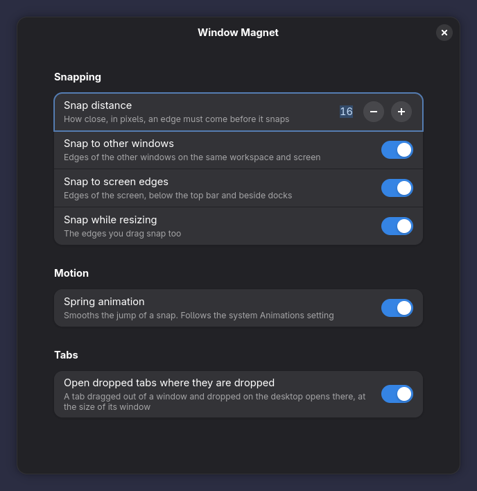

# Window Magnet

[](https://github.com/maximeallanic/window-magnet/actions/workflows/ci.yml)
[](LICENSE)
[](#compatibility)

*[Lire en français](README.fr.md)*

A GNOME Shell extension that makes window edges magnetic. Drag a window close to another one and its edge snaps flush
against it, with a short spring so the snap feels physical instead of abrupt. Pull a little further and it lets go.


*Recorded in a real (nested, headless) GNOME Shell 51, at real speed. [MP4 version](media/demo.mp4).*

## Features

- **Snap while moving**: both edges of each axis snap to the edges of the other windows on the same workspace and
  monitor, and to the edges of the screen (below the top bar, beside docks). Tops align, sides butt together.
- **Snap while resizing**: the edges you drag snap too, live, without the window flickering between two sizes.
- **A spring, not a jolt**: each snap is smoothed by a fast Material 3 Expressive spring. It follows GNOME's
  *Reduce Animation* setting.
- **Holds, then lets go**: a snapped window stays put until the pointer moves further than the snap distance.
- **Tabs land where you drop them**: a tab dragged out of an app window and dropped on the desktop opens its window
  at the drop point, at the size of the window it came from (Wayland apps cannot place their own windows).
- Nothing else changes: no tiling layout, no keyboard shortcuts, no restyling. It only acts while you drag.

## Install

### From extensions.gnome.org

Not published yet. Once it is, this will be the easiest way: install it from the website or the *Extension Manager*
app.

### One command

```sh
curl -fsSL https://raw.githubusercontent.com/maximeallanic/window-magnet/main/install.sh | bash
```

This downloads the release zip of the pinned version from GitHub, checks its SHA-256 against the value written in
`install.sh`, installs it for your user with `gnome-extensions install` and enables it. No root, no build tools.
On Wayland, **log out and back in once** after the first install: GNOME Shell discovers new extensions at login.
Read the script first if you prefer: it is short and commented.

### Manually, from the zip

1. Download `window-magnet@maximeallanic.github.io.shell-extension.zip` from the
   [latest release](https://github.com/maximeallanic/window-magnet/releases/latest)
   (and `SHA256SUMS` to check it: `sha256sum -c SHA256SUMS`).
2. Install it: `gnome-extensions install --force window-magnet@maximeallanic.github.io.shell-extension.zip`
3. Log out and back in, then: `gnome-extensions enable window-magnet@maximeallanic.github.io`

### From source

```sh
git clone https://github.com/maximeallanic/window-magnet.git
cd window-magnet
./install.sh --from-source       # needs gettext (msgfmt) to build the translations
```

### Check that it works

```sh
curl -fsSL https://raw.githubusercontent.com/maximeallanic/window-magnet/main/verify.sh | bash
```

`verify.sh` changes nothing. It checks the GNOME Shell version, the installation, the settings schema, whether the
extension is enabled and running, and tells you what to do for anything that is not right.

### Uninstall

```sh
curl -fsSL https://raw.githubusercontent.com/maximeallanic/window-magnet/main/uninstall.sh | bash
# or, from a checkout: ./uninstall.sh [--purge]
```

The extension is disabled (no window stays offset), removed, and taken out of the enabled list. `--purge` also
resets its settings. The Extensions app's *Remove* button does the same, minus the settings.

## Settings

Open them with the Extensions app (*Window Magnet*, gear button) or `gnome-extensions prefs window-magnet@maximeallanic.github.io`.



| Setting | Key | Default |
|---------|-----|---------|
| Snap distance: how close an edge must come before it snaps, 4 to 64 px | `snap-threshold` | `16` |
| Snap to other windows | `snap-to-windows` | on |
| Snap to screen edges | `snap-to-screen-edges` | on |
| Snap while resizing | `snap-while-resizing` | on |
| Spring animation | `spring-animation` | on |
| Open dropped tabs where they are dropped | `place-dropped-tabs` | on |

From a terminal (the schema ships with the extension, hence `--schemadir`):

```sh
gsettings --schemadir ~/.local/share/gnome-shell/extensions/window-magnet@maximeallanic.github.io/schemas \
    set org.gnome.shell.extensions.window-magnet snap-threshold 24
```

## Compatibility

| GNOME Shell | Status |
|-------------|--------|
| 51 | Supported, tested (Debian testing, Wayland) |
| 50 and older | Not declared: untested |

Window Magnet uses only public GNOME Shell and Mutter APIs. Other distributions running GNOME Shell 51 should work;
reports are welcome. A newer Shell is added to the list once it has been tested
(see [docs/extensions-gnome-org.md](docs/extensions-gnome-org.md)).

## FAQ

**I installed it but nothing happens.** On Wayland, log out and back in once after installing. Then run `verify.sh`
(above): it says what is missing.

**The window snaps but there is no spring.** The spring follows GNOME's animation setting: Settings, Accessibility, Seeing,
*Reduce Animation* must be off. Also check the *Spring animation* switch.

**Can I move a window without snapping?** Move it further than the snap distance and it follows the pointer exactly.
A smaller snap distance makes snaps rarer; *Snap to other windows* and *Snap to screen edges* turn each source off.

**Does it work with keyboard moves (Alt+F7) or tiling extensions?** It snaps pointer and touch drags only. It does not
change GNOME's edge tiling (drag to the top to maximize, to a side for half screen). Other extensions that also move
windows during a drag may fight with it; please report such cases.

**Multiple monitors?** Snapping uses the windows and the work area of the monitor the window is on.

**Which tabs does "dropped tabs" work with?** Any app whose tabs can be dragged out into a new window under Wayland
(libadwaita tab bars, for example). Nothing is app-specific: the extension recognises the drag Mutter shows and the
window the same app creates right after. If the tab is dropped into another window, nothing moves.

**Does it collect anything or talk to the network?** No. It spawns no process, opens no connection and reads no file.

## How it works

See [docs/how-it-works.md](docs/how-it-works.md). Development, tests and media regeneration:
[docs/development.md](docs/development.md).

## Contributing

Bug reports, tests on other setups and translations are welcome. Read [CONTRIBUTING.md](CONTRIBUTING.md) and the
[code of conduct](CODE_OF_CONDUCT.md). Security issues: [SECURITY.md](SECURITY.md).

## Credits and licence

MIT, see [LICENSE](LICENSE). The spring comes from the motion toolkit of
[m3e-gnome-extensions](https://github.com/maximeallanic/m3e-gnome-extensions) (MIT, vendored unmodified), whose spring
solver is a port of Jetpack Compose's (Apache-2.0). Details in [NOTICE.md](NOTICE.md).
